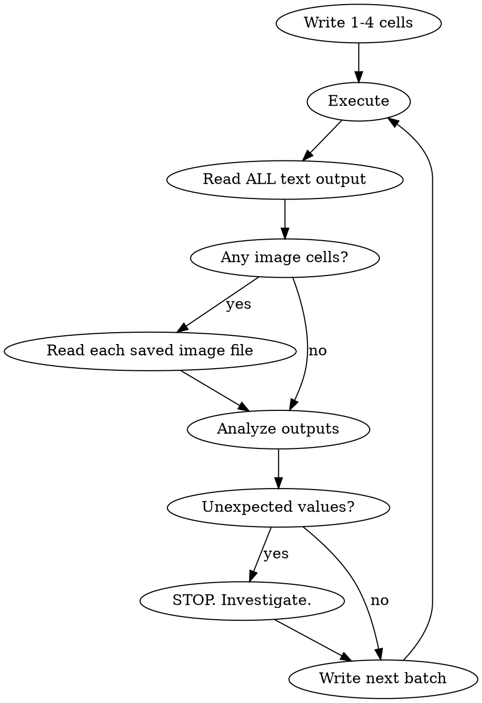

# Iterative Data Science Workflow

## Overview

Work in small, verified batches. Write a few cells, execute them, read ALL output, then proceed. Never write long stretches of code without verifying intermediate results.

**Violating the letter of these rules is violating the spirit of these rules.** Every rule below exists because of a real failure mode observed in practice. Do not rationalize around them.

## Core Loop

```
Write small batch of cells → Execute → Read ALL output → Proceed
```



**ALL outputs matter.** Pause and review everything: dataframe shapes, value counts, error messages, model metrics, dtypes, correlation values — not just plots. Numeric outputs that determine downstream parameters (vocabulary size, class balance, cluster count, correlation strengths) deserve a genuine pause.

**Never write 10+ cells blind.** Assumptions break silently. A natural batch is 1-4 cells that form a logical unit (e.g., compute + print stats, or a single plot).

## The One Output Type Per Cell Rule

**NEVER combine text output and image output in the same cell.**

A cell must produce EITHER text output (print statements, dataframe displays) OR image output (plt.show()), never both. When both exist in one cell, reading the notebook back shows "Outputs are too large to include" — the image data hides the text output, making verification impossible.

```python
# BAD — mixed output types
print(corr.round(3))            # text output
sns.heatmap(corr, annot=True)   # image output
plt.savefig(...)
plt.show()
print("Saved: figure.png")      # more text output
```

```python
# GOOD — split into two cells

# Cell 1: image only
sns.heatmap(corr, annot=True)
plt.savefig(...)
plt.show()

# Cell 2: text only
print("Correlation matrix:")
print(corr.round(3))
```

**This includes trivial print statements.** Do NOT add `print("Saved: filename.png")` to plot cells. The saved file's existence is verified by reading it — the print adds nothing and pollutes the output type.

**How to split:** Put computation and text output in one cell, plot in the next (or vice versa). The order depends on what's natural — stats before or after the plot that visualizes them.

| Pattern | Split Into |
|---------|-----------|
| Compute + print stats + plot | Cell 1: compute + print stats. Cell 2: plot only |
| Plot + print correlation matrix | Cell 1: plot only. Cell 2: print matrix |
| Compute CTR + print describe + plot histogram | Cell 1: compute + print. Cell 2: plot |

## Reading ALL Output — The Verification Protocol

After executing cells, you MUST verify EVERY output. This means:

**For text-output cells:** Read the notebook to see the printed output inline. Verify shapes, dtypes, value counts, statistics, and any numeric results. If notebook reading truncates or hides output, use Bash to extract the specific cell's output with jq.

**For image-output cells:** Read the saved image file with the Read tool. You cannot see inline notebook renders. The saved file is the ONLY way to see what you produced.

```
Execute batch → Read notebook (text outputs visible) → Read each saved image → Proceed
```

**Do NOT claim ANY output "looks correct" without having read it.** Do NOT rely on error-free execution as evidence of correctness. A cell can execute without error and produce completely wrong results.

**Do NOT skip text output verification.** If you wrote `print(df.describe())`, you MUST read that output before proceeding. The numbers in that output determine what you do next.

## Visualization: Dual Output Rule

Every plot MUST be both rendered inline AND saved to disk.

```python
plt.savefig("figures/notebook-name/01_correlation_heatmap.png", dpi=150, bbox_inches="tight")
plt.show()
```

**Always `savefig` BEFORE `show`** — some backends clear the figure buffer on `show()`.

**No other code in a plot cell.** The cell should contain only the figure creation, savefig, and show. No print statements. No computation. No variable assignments that produce display output.

### Reading Your Own Plots

You cannot see inline notebook renders. After saving a plot, you MUST use the Read tool on the saved image file to actually see what you produced.

```
1. plt.savefig(...) + plt.show()  [in an image-only cell]
2. Read tool → figures/notebook-name/01_plot.png
3. Analyze what you see, then proceed
```

**Do NOT skip step 2.** Do NOT claim a plot "looks correct" without reading the file.

## Plan Mode Protocol

When entering plan mode for data science work, the plan MUST encode the iterative verification loop. Plans that list steps without specifying execute-and-verify checkpoints will fail.

**Every plan batch must specify:**
1. What cells to write (code description)
2. What to execute
3. What outputs to verify (specific text outputs AND specific image files)
4. What to check for (expected shapes, value ranges, figure contents)

```markdown
# BAD plan step — no verification built in
**Step 3: Correlation heatmap**
- Compute correlation matrix
- Plot heatmap
- Save to figures/

# GOOD plan step — verification is explicit
**Batch 3: Correlation heatmap**
- Cell 1 (image): Compute correlation matrix, plot heatmap, save to `figures/assignment/03_heatmap.png`
- Cell 2 (text): Print `corr.round(3)` matrix
- Execute, Read notebook for correlation values, Read saved image
- Verify: all correlations in [-1, 1], check for unexpected near-zero or near-perfect correlations
```

**Plans should use "Batch N" not "Step N"** to reinforce that each unit is a write-execute-verify cycle, not just a task to complete.

## Figures Folder Structure

**Always** use `figures/<notebook-name>/` subfolders — even with a single notebook.

```
project/
  analysis.ipynb
  figures/
    analysis/
      01_rating_distribution.png
      02_correlation_heatmap.png
```

**Notebook name** = filename without `.ipynb` extension. Create the directory early (first cell or before first plot).

## Naming Convention

**Sequential + descriptive:** `NN_descriptive_name.png`

- `01_rating_distribution.png`
- `02_wordcloud_all_reviews.png`
- `03_tfidf_top_terms.png`

## Red Flags — STOP If You Catch Yourself Thinking These

| Thought | Reality |
|---------|---------|
| "I'll just add a quick print to this plot cell" | NO. Separate cell. One output type per cell. Always. |
| "The cell executed without error so it's fine" | Error-free ≠ correct. Read the output. |
| "I already know what this will print" | You don't. Read it. Values surprise you. |
| "I'll verify the text outputs later in bulk" | You won't. Verify now, per batch. |
| "Reading the image is enough, the stats are obvious" | Stats are never obvious. Read them. |
| "This is just a simple print, I don't need to verify" | Simple prints reveal dtype mismatches, unexpected NaNs, wrong shapes. Read it. |
| "I'll batch more cells to be efficient" | Efficiency without verification is rework. Small batches save time. |
| "The plan says what to do, I don't need to verify" | Plans don't execute. Verification does. |

## Common Mistakes

| Mistake | Fix |
|---------|-----|
| Writing 10+ cells then running all at once | Stop every 1-4 cells, verify output |
| Mixing print() and plt.show() in same cell | One output type per cell. Always split. |
| Adding `print("Saved: ...")` to plot cells | Remove it. Verify by reading the saved file. |
| Saving plot but not reading the file | Always Read the saved image after saving |
| Reading images but skipping text outputs | Read ALL outputs — text AND images |
| Flat `figures/` folder without notebook subfolder | Always `figures/<notebook-name>/` |
| `plt.show()` without `plt.savefig()` | Always both, savefig first |
| Claiming plot "looks good" without reading it | Read the file. No exceptions. |
| Proceeding after unexpected `.shape` or dtypes | Pause. Investigate. Then proceed. |
| Plan steps without verification checkpoints | Every batch in plan specifies what to verify |
